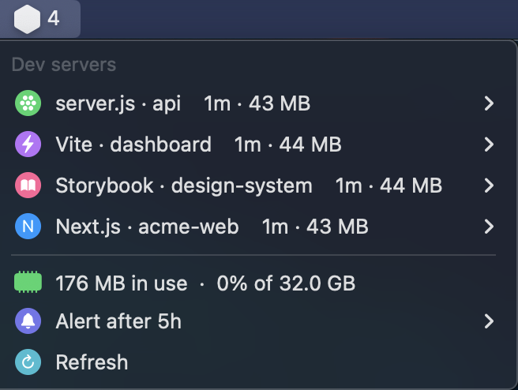

# SwiftBar plugins

[SwiftBar](https://github.com/swiftbar/SwiftBar) plugins for macOS.



## Dev servers

`devservers.1m.sh` puts your running dev servers in the menu bar. It refreshes every minute.

- It lists every `node`, `bun`, `deno` or `next-server` process that listens on a TCP port.
- Processes are grouped by process group, so one `pnpm dev` is one row, even when it starts several processes.
- Each row shows the tool, the project name, the uptime and the memory used. Known tools are Next.js, Vite, Storybook and Portless. Other servers are named after the script they run.
- The project name is the git repo the server runs in, or its folder name outside a repo.
- Each row has a submenu to open the server in the browser, show its folder in Finder, or stop it. Stop sends `SIGTERM` to the whole process group.
- When a server runs longer than the alert limit, you get one notification for it. The limit is 5 hours by default, and the **Alert after** menu changes it.
- A row turns orange past the limit, or when it uses 2 GB of memory or more.
- The footer shows the total memory in use. Click it to open Activity Monitor.

### Requirements

- macOS with SwiftBar 2.x
- zsh, `lsof` and `ps`, which ship with macOS

### Install

Clone the repo and choose its folder as SwiftBar's plugin folder:

```sh
git clone https://github.com/rashedInt32/swiftbar.git ~/swiftbar
```

The `.swiftbarignore` file keeps the README and LICENSE out of SwiftBar's plugin list.

If you already have a plugin folder, link the plugin into it instead:

```sh
ln -s ~/swiftbar/devservers.1m.sh "/path/to/your/plugin/folder/"
```

### Settings

All settings are optional. Put them in `~/.config/devservers/env`. It's a zsh file that the plugin sources on every run.

```zsh
DEVSERVERS_LIMIT_HOURS=4
DEVSERVERS_IGNORE='my-proxy|other-tool'
```

| Variable | Default | What it does |
| --- | --- | --- |
| `DEVSERVERS_LIMIT_HOURS` | `5` | Hours before the alert, or `off`. A choice in the **Alert after** menu wins over this. |
| `DEVSERVERS_IGNORE` | none | A regex matched against each listener's command line. Matching processes are hidden. Use it for tools like package-manager proxies that listen on a port. |
| `DEVSERVERS_STATE` | `~/.cache/devservers/notified` | Remembers which servers were already notified. |
| `DEVSERVERS_CONFIG` | `~/.config/devservers/limit` | Where the **Alert after** menu saves its choice. |
| `DEVSERVERS_ENV` | `~/.config/devservers/env` | The settings file itself. |
| `DEVSERVERS_TENANTS_ROOT` | none | See [Worktree tenants](#worktree-tenants). |
| `DEVSERVERS_TENANTS_BIN` | none | See [Worktree tenants](#worktree-tenants). |

### Worktree tenants

This part is optional. It's for running dev servers from git worktrees through your own launcher script. The plugin can show those servers by worktree name and stop them through the launcher. Set both variables to turn it on:

- `DEVSERVERS_TENANTS_ROOT` is the folder that holds the worktrees. Your launcher writes each worktree's process id to `<root>/.run/<name>.pid`.
- `DEVSERVERS_TENANTS_BIN` is the launcher. The plugin runs `<launcher> down <name>` to stop one.

A server counts as a tenant only if its pid file names the server or one of its parent processes. A server you started by hand inside a worktree shows up as a normal row.

Tenant rows open `https://<name>.localhost`. If either variable is unset, or the launcher isn't executable, tenant support stays off.

## License

[MIT](LICENSE)
